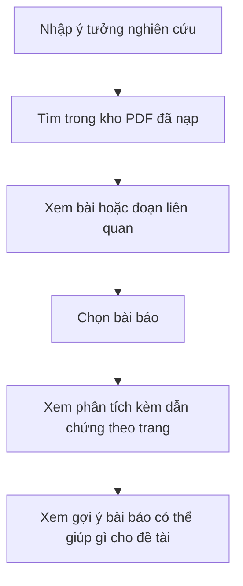

# Phạm vi MVP và luồng người dùng

## Mục tiêu
Xây dựng công cụ hỗ trợ nhà nghiên cứu tìm và phân tích bài báo khoa học liên quan đến ý tưởng nghiên cứu. Mỗi nhận định quan trọng cần có dẫn chứng để kiểm tra với tài liệu gốc.

## Người dùng mục tiêu
Sinh viên, học viên cao học và nhà nghiên cứu đang tìm tài liệu hoặc xây dựng đề tài.

## Luồng người dùng

## Trong phạm vi bản đầu
- Nạp PDF có văn bản trích xuất được.
- Trích xuất văn bản, giữ số trang.
- Tìm bài hoặc đoạn liên quan trong kho tài liệu đã nạp.
- Phân tích mục tiêu, phương pháp, dữ liệu, kết quả và hạn chế.
- Hiển thị dẫn chứng trang/đoạn nguồn.
- Gợi ý cách bài báo hỗ trợ ý tưởng nghiên cứu.

## Ngoài phạm vi bản đầu
- Tự tìm kiếm trên toàn Internet.
- Khẳng định chắc chắn đề tài chưa từng được nghiên cứu.
- Đảm bảo trích xuất chính xác mọi bảng, biểu đồ hoặc PDF scan.
- Thay thế việc người dùng tự đọc và xác minh bài báo.

## Nguyên tắc độ tin cậy
- Chỉ nhận định dựa trên tài liệu đã nạp.
- Gắn nhận định quan trọng với trang hoặc đoạn nguồn khi có thể.
- Nếu không có thông tin, ghi “Không tìm thấy trong bài”.
- Gợi ý chỉ mang tính tham khảo; người dùng cần kiểm tra lại nguồn.

## Câu hỏi cần giảng viên xác nhận
- Phạm vi bản đầu như trên đã phù hợp yêu cầu đồ án chưa?
- Có cần đưa tìm kiếm URL vào bản đầu hay chỉ xử lý PDF đã nạp?
- Những mục phân tích nào bắt buộc trong đầu ra?

## Trạng thái
Bản nháp chờ giảng viên góp ý.
